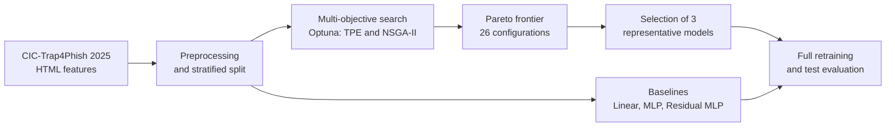

# Deployment-Aware Multi-Objective Optimization of Neural Phishing Detectors

[](https://www.python.org/)
[](https://pytorch.org/)
[](https://optuna.org/)
[](https://scikit-learn.org/)

Official code for the paper **"Deployment-Aware Multi-Objective Optimization of Neural Phishing Detectors Using HTML-Based Features"**, presented at the 11th Ecuadorian Conference on Information and Communication Technologies (TICEC), scientific track.

**Authors:** Mishell Guano, Leticia Lemus Cárdenas, Juan Pablo Astudillo León

## Overview

Phishing detectors are usually selected by accuracy or F1-score alone. In real deployments (secure gateways, browser extensions, mobile and edge devices), a classifier must also be fast and small.

This project treats **F1-score, inference latency, and model size as simultaneous optimization objectives**, rather than metrics reported after training. Using Optuna, we search over MLP and residual MLP architectures with two multi-objective samplers, TPE and NSGA-II, and build a Pareto frontier of deployment trade-offs.

**Key result:** the optimized models are up to **130.2x faster** than the strongest baseline at the model level, with a controlled loss in F1-score.

## Highlights

- Deployment-aware pipeline that optimizes F1-score, inference time, and model size jointly.
- Comparison of TPE and NSGA-II across MLP and residual MLP architecture families.
- 26 Pareto-optimal configurations, from which 3 representative models are retrained and evaluated.
- Compact final classifiers, down to 4.24 µs per inference and 0.0097 MB on CPU.

## Workflow



## Dataset

We use the HTML component of the **CIC-Trap4Phish 2025** dataset from the Canadian Institute for Cybersecurity (University of New Brunswick). The dataset is available at [unb.ca/cic/datasets](https://www.unb.ca/cic/datasets/).

| Property | Value |
|---|---|
| Processed samples | 19,997 |
| Input features | 13 engineered numerical HTML features |
| Feature types | Punctuation indicators, tag statistics, whitespace ratio, entropy, form count, embedded script count, link statistics |
| Split (stratified) | 11,997 train / 4,000 validation / 4,000 test |
| Scaling | StandardScaler fitted on the training partition only |

## Method

**Objectives**

```
maximize F1-score    minimize inference time    minimize model size
```

**Search setup**

| Setting | Value |
|---|---|
| Architectures | MLP, Residual MLP |
| Samplers | TPE, NSGA-II |
| Studies | 4 (architecture x sampler) |
| Trials per study | 30 |
| Tuning subset | 40% of the training partition (4,798 samples), fixed across studies |
| Epochs per trial | 10 |
| Final retraining | 20 epochs on the full training partition |
| Random seed | 42 |

**Search space**

| Hyperparameter | Range |
|---|---|
| Sampled hidden stages | {1, 2, 3, 4} |
| Units per stage | [32, 256] |
| Activation | ReLU, Tanh, LeakyReLU |
| Dropout | [0.0, 0.5] |
| Learning rate | [1e-4, 1e-2], log-uniform |
| Batch size | {32, 64, 128} |
| Optimizer | Adam, AdamW |

**Pareto-optimal configurations per study**

| Study | Configurations |
|---|---|
| MLP + TPE | 9 |
| MLP + NSGA-II | 6 |
| Residual MLP + TPE | 8 |
| Residual MLP + NSGA-II | 3 |
| **Total** | **26** |

## Results

Final evaluation on the held-out test set. Latency is model-level, single-sample CPU inference.

| Model | F1-score | Accuracy | CPU latency (µs) | Size (MB) | Speedup |
|---|---|---|---|---|---|
| Linear baseline | 0.8153 | 0.8010 | 144.33 | 0.00005 | 3.8x |
| MLP baseline | 0.8651 | 0.8638 | 389.33 | 0.0037 | 1.4x |
| Residual MLP baseline | **0.8853** | **0.8833** | 552.09 | 0.0230 | 1.0x |
| MLP + TPE | 0.8765 | 0.8765 | 6.61 | 0.0168 | 83.5x |
| Residual MLP + NSGA-II | 0.8519 | 0.8513 | 32.48 | 0.0151 | 17.0x |
| MLP + NSGA-II | 0.8593 | 0.8570 | **4.24** | 0.0097 | **130.2x** |

Speedup is relative to the residual MLP baseline.

**Takeaways**

- **MLP + TPE** keeps a competitive F1-score (-0.0088) while running 83.5x faster than the strongest baseline.
- **MLP + NSGA-II** is the fastest and smallest optimized model, at 4.24 µs and 0.0097 MB (-0.0260 F1).
- The configuration selected as "balanced" during validation (Residual MLP + NSGA-II) is dominated by MLP + TPE after full retraining. Pareto relationships observed during tuning do not always transfer unchanged to final evaluation.

## Choosing a Model for Your Deployment

| Scenario | Main constraint | Suggested model |
|---|---|---|
| Browser extension or edge device | Memory and latency | MLP + NSGA-II |
| Real-time gateway or API | High volume with competitive accuracy | MLP + TPE |
| Offline or forensic analysis | Maximum predictive performance | Residual MLP baseline |

## Getting Started

```bash
git clone https://github.com/mishellguanoc/Multi-ObejectiveNN_Project.git
cd Multi-ObejectiveNN_Project
pip install torch scikit-learn optuna numpy
```

The repository includes the preprocessing scripts, the optimization studies, the Pareto extraction procedure, the selected configurations, and the retraining pipeline.

## Experimental Environment

| Component | Specification |
|---|---|
| CPU | Intel Core Ultra 7 |
| GPU | NVIDIA GeForce RTX 3050 (6 GB VRAM) |
| RAM | 16 GB |
| Frameworks | PyTorch, scikit-learn, Optuna |

CUDA was used during hyperparameter search and training. Final latency values are model-level CPU measurements.

## Scope and Limitations

- Latency values cover **classifier inference only**. HTML retrieval, DOM parsing, feature extraction, preprocessing, and system integration are out of scope.
- Theoretical throughput (for example, about 235,849 predictions per second for MLP + NSGA-II) is derived from single-sample latency. It is not a measured end-to-end throughput.
- Microsecond-scale latencies depend on hardware, threading, and system load. Relative speedups are more informative than absolute values.
- Results come from a single processed HTML feature dataset.

## Future Work

- End-to-end prototype in a browser, gateway, mobile, or edge environment.
- Evaluation on additional datasets, temporally separated samples, and live traffic.
- Repeated runs with multiple seeds, confidence intervals, and larger trial budgets.
- Comparison with classical lightweight classifiers such as Decision Trees, Random Forest, XGBoost, and LightGBM.
- Hardware-aware objectives such as quantization, pruning, and energy consumption.

## Citation

If you use this work, please cite:

```bibtex
@misc{guano2026deployment,
  title  = {Deployment-Aware Multi-Objective Optimization of Neural Phishing Detectors Using HTML-Based Features},
  author = {Guano, Mishell and Lemus C{\'a}rdenas, Leticia and Astudillo Le{\'o}n, Juan Pablo},
  year   = {2026},
  note   = {Presented at the 11th Ecuadorian Conference on Information and Communication Technologies (TICEC)}
}
```

## Acknowledgments

Communication Networks and Intelligent Services Research Group (ComNet Innova YT), School of Mathematical and Computational Sciences, Yachay Tech University, Ecuador. Universidad de Guadalajara, México. Universidad Internacional del Ecuador (UIDE).
